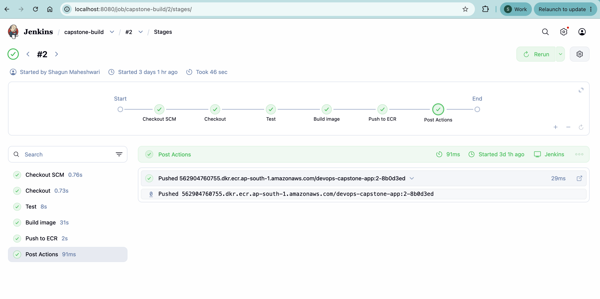
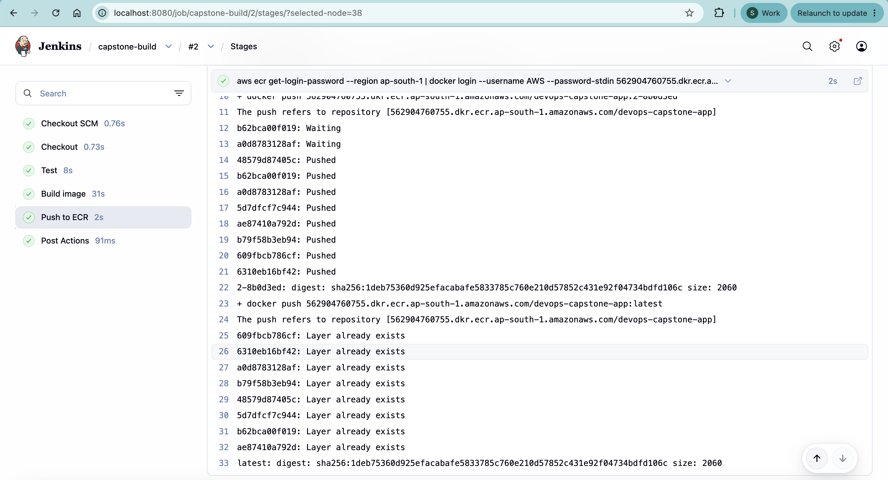
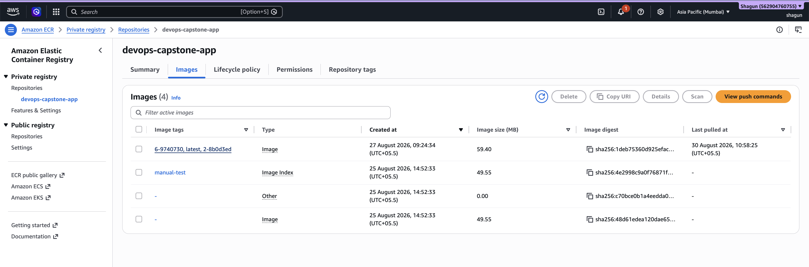
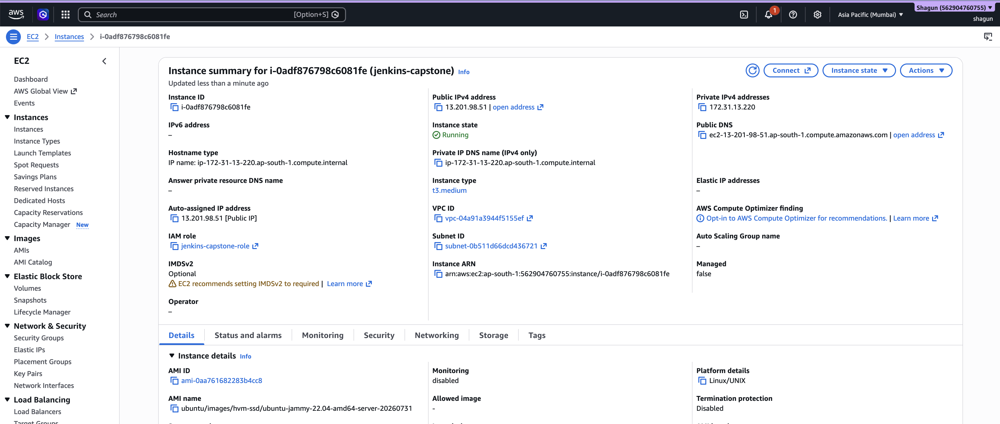
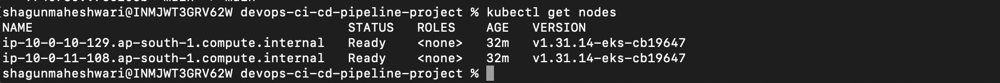
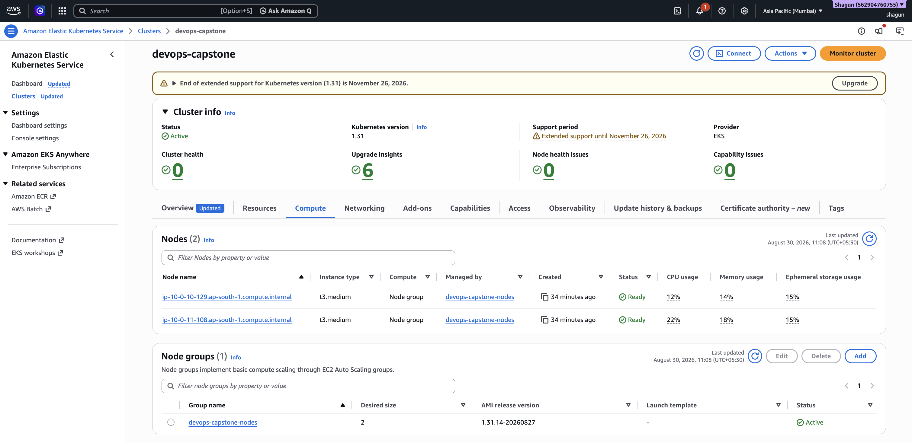
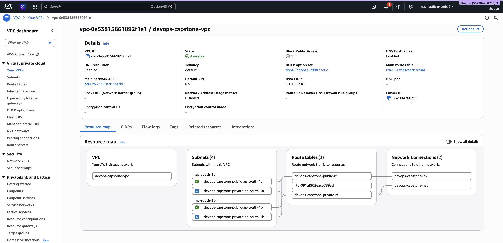
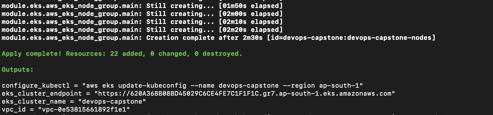
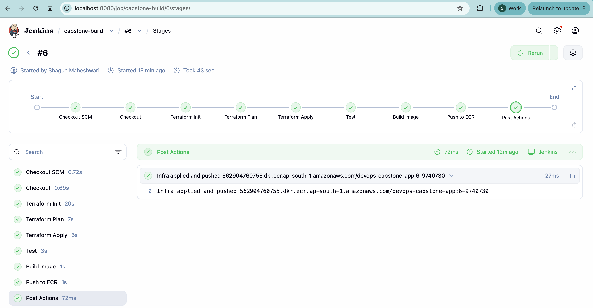

# Project 4 — End-to-End DevOps CI/CD Capstone

Automated pipeline for a Dockerized Flask app on **AWS EKS**, orchestrated by **Jenkins**: CI and image scanning, infrastructure (Terraform), configuration (Ansible), deployment (Kubernetes), and observability (Prometheus/Grafana).

| Evaluation (per [docs/task.md](docs/task.md)) | Weight |
|-----------------------------------------------|--------|
| Implementation | 75% |
| Documentation | 15% |
| Cost optimization | 10% |

**Region:** `ap-south-1`

---

## Architecture

Diagram and IAM: **[docs/architecture.md](docs/architecture.md)**

---

## Project goals

| Goal | Delivery | Documentation |
|------|----------|---------------|
| Architecture (LB, orchestration, monitoring) | VPC, EKS, LoadBalancer, Prometheus/Grafana | [architecture.md](docs/architecture.md) |
| Terraform (VPC, subnets, EKS, S3 state) | `terraform/` + Jenkins stages | [terraform.md](docs/terraform.md) |
| Ansible configuration | `ansible/` after Terraform | [ansible.md](docs/ansible.md) |
| App on EKS (scale, resilience) | `kubernetes/` — probes, HPA (load-tested 2 → 5 pods) | [kubernetes.md](docs/kubernetes.md), [autoscaling-test.md](docs/autoscaling-test.md) |
| Jenkins CI/CD | [jenkins/Jenkinsfile](jenkins/Jenkinsfile) | [pipeline.md](docs/pipeline.md), [jenkins.md](docs/jenkins.md) |
| Prometheus & Grafana | `monitoring/` | [monitoring.md](docs/monitoring.md) |

---

## Jenkins pipeline

| Capstone stage ([task.md](docs/task.md)) | Jenkins stages |
|------------------------------------------|----------------|
| **1. Build** | Test → Build image → Scan image (Trivy) → Push to ECR |
| **2. Infrastructure** | Terraform Init → Plan → Apply *(if plan has changes)* |
| **3. Configuration** | Ansible Configure |
| **4. Deployment** | Deploy → Post-deploy smoke test |
| **5. Test & monitor** | Monitoring → Pipeline validation |

Details: [sprint-7.md](docs/sprint-7.md) · Triggers: [jenkins-triggers.md](docs/jenkins-triggers.md)

```
Checkout → Test → Build → Scan → Push ECR → Terraform → Ansible → Deploy → Smoke → Monitoring → Validation
```

---

## Repository layout

```
app/           # Flask app, Dockerfile, pytest
terraform/     # VPC, EKS, S3 backend, IAM
ansible/       # Playbooks (Jenkins CI host)
jenkins/       # Jenkinsfile
kubernetes/    # Deployment, Service, HPA (tests/: manual HPA load test)
monitoring/    # Prometheus, Grafana, exporters
docs/          # Runbooks, sprint logs, screenshots
```

---

## Sprint summary

| Sprint | Topic | Documentation |
|--------|--------|---------------|
| 1 | Docker, ECR, Jenkins | [sprint-1.md](docs/sprint-1.md) |
| 2 | Terraform + Jenkins | [terraform.md](docs/terraform.md) |
| 3 | Ansible | [ansible.md](docs/ansible.md) |
| 4 | Deploy to EKS | [pipeline.md](docs/pipeline.md) |
| 5 | Monitoring | [monitoring.md](docs/monitoring.md) |
| 6 | E2E testing, cost, sign-off | [sprint-6.md](docs/sprint-6.md) |
| 7 | Fail-fast CI, Trivy, conditional apply | [sprint-7.md](docs/sprint-7.md) |

---

## Evidence screenshots

### Sprint 1 — Docker, ECR, Jenkins






### Sprint 2 — Terraform







### Sprint 3 — Ansible


### Sprint 4 — EKS deploy


### Sprint 5 — Monitoring


### Sprint 6 — Full pipeline


### Sprint 7 — Hardening


**Autoscaling test:** under load, CPU reached 113% of the 70% target and the HPA scaled from 2 to the maximum of 5 pods, spread across both availability zones, then returned to 2 after the load stopped. Details: [autoscaling-test.md](docs/autoscaling-test.md).


Index: [docs/screenshots/README.md](docs/screenshots/README.md)

---

## Quickstart

### Prerequisites

- AWS account with permissions for EKS, ECR, VPC, S3, DynamoDB and IAM
- Jenkins on EC2 with an instance role; job = Pipeline from SCM (`jenkins/Jenkinsfile`, branch `*/main`)
- S3 state bucket and DynamoDB lock table (one-time bootstrap, see [terraform.md](docs/terraform.md))
- ECR repository `devops-capstone-app`
- Jenkins credential `slack-webhook-url` (optional, for failure alerts)
- Operator access through SSM Session Manager (AWS CLI v2 + Session Manager plugin); scoped operator policy in [docs/iam/](docs/iam/demo-operator-policy.json)

### Local app

```bash
cd app
docker build -t app:local .
docker run -p 8080:8080 app:local
curl http://localhost:8080/health
pytest -q
```

### Jenkins pipeline

Configure job per [jenkins.md](docs/jenkins.md): Pipeline from SCM, `jenkins/Jenkinsfile`, `*/main`.  
Verification checklist: [e2e-testing.md](docs/e2e-testing.md).

### Infrastructure

```bash
cd terraform && terraform init && terraform validate
aws eks describe-cluster --name devops-capstone --region ap-south-1 --query cluster.status
kubectl get nodes
```

Teardown: [cost-optimization.md](docs/cost-optimization.md)

### Application

```bash
kubectl get deploy,svc,hpa -n capstone-app
APP=$(kubectl get svc capstone-app -n capstone-app -o jsonpath='{.status.loadBalancer.ingress[0].hostname}')
curl -sf "http://${APP}/health"
```

### Monitoring

```bash
kubectl get pods -n monitoring
kubectl port-forward svc/grafana -n monitoring 3000:80
kubectl port-forward svc/prometheus -n monitoring 9090:9090
```

---

## Documentation

| Topic | File |
|-------|------|
| Requirements | [docs/task.md](docs/task.md) |
| Architecture | [docs/architecture.md](docs/architecture.md) |
| Jenkins setup | [docs/jenkins.md](docs/jenkins.md) |
| Terraform / EKS | [docs/terraform.md](docs/terraform.md) |
| Ansible | [docs/ansible.md](docs/ansible.md) |
| Pipeline & deploy | [docs/pipeline.md](docs/pipeline.md) |
| Kubernetes | [docs/kubernetes.md](docs/kubernetes.md) |
| Autoscaling test | [docs/autoscaling-test.md](docs/autoscaling-test.md) |
| Monitoring | [docs/monitoring.md](docs/monitoring.md) |
| E2E testing | [docs/e2e-testing.md](docs/e2e-testing.md) |
| Cost (10%) | [docs/cost-optimization.md](docs/cost-optimization.md) |
| Operator IAM policy | [docs/iam/demo-operator-policy.json](docs/iam/demo-operator-policy.json) |
| Sprint 6 / 7 logs | [docs/sprint-6.md](docs/sprint-6.md), [docs/sprint-7.md](docs/sprint-7.md) |

---

## Deliverables

- End-to-end Jenkins pipeline (build/scan, Terraform, Ansible, deploy, monitoring)
- Terraform-managed VPC, EKS, S3 remote state
- Ansible in pipeline; app on EKS with health checks and an HPA load-tested from 2 to 5 pods
- Prometheus, Grafana, alert rules; Slack on failure (credential)
- Documentation, cost analysis, screenshots

---

## Cost & lessons learned

**Actual spend:** $99.64 of usage over September–October 2026, against ~$420 if everything had run continuously (about 76% less), fully covered by AWS credits (net $0.00). Savings came from destroying the cluster between sessions and stopping Jenkins when idle. Breakdown and evidence: [cost-optimization.md](docs/cost-optimization.md#actual-spend).

**Lessons learned:** IAM instance profiles instead of stored keys · SSM access instead of public ports · metrics-server for HPA · HPA load test (2 → 5 pods) · Sprint 7 fail-fast pipeline and Trivy gate · recovering from an interrupted `terraform apply` with `terraform import`. Details in [sprint-7.md](docs/sprint-7.md) and the sprint logs in `docs/`.
