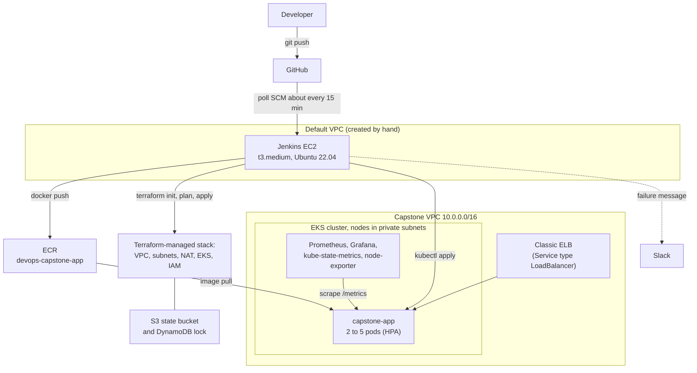
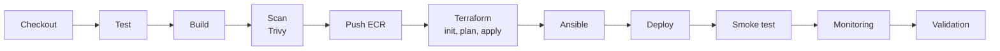

# Architecture

How the capstone fits together, what each tool owns, and which parts are still manual.
Region for everything: `ap-south-1` (Mumbai).

## System overview

## Pipeline order

Sprint 7 runs CI and image scan before Terraform (fail-fast, Trivy gate). See [sprint-7.md](sprint-7.md).

CI stages run first, so a failing test or a CRITICAL vulnerability stops the run before Terraform. Terraform applies only when the plan reports changes. Details: [pipeline.md](pipeline.md), [sprint-7.md](sprint-7.md) and [jenkins.md](jenkins.md).

## Who provisions what

| Component | Provisioned by | Notes |
|---|---|---|
| Jenkins EC2, its IAM role and instance profile, security group, key pair | **Manual** (AWS CLI, Sprint 1) | Lives in the default VPC and must survive `terraform destroy`. Setup and rebuild steps: [jenkins.md](jenkins.md). Not in Terraform; see [terraform.md](terraform.md). |
| ECR repository `devops-capstone-app` | Manual (AWS CLI, Sprint 1) | Images tagged `<build>-<commit>` plus `latest`. |
| S3 state bucket and DynamoDB lock table | Manual bootstrap (Sprint 2) | Terraform cannot create the backend it stores its own state in. |
| VPC, subnets, internet gateway, NAT gateway, route tables | Terraform | `terraform/modules/vpc` |
| EKS cluster, managed node group, cluster and node IAM roles | Terraform | `terraform/modules/eks`. Jenkins creates the cluster, so EKS gives its role admin as creator; an explicit Jenkins access entry exists only when `jenkins_role_arn` is set. |
| Host tooling on Jenkins (Docker, kubectl, AWS CLI v2, jq, docker group) | Ansible | `ansible/`, runs on the Jenkins host itself ([ansible.md](ansible.md)) |
| App Deployment, Service, HPA, metrics-server | Jenkins (`kubectl apply`) | `kubernetes/` ([kubernetes.md](kubernetes.md)) |
| Prometheus, Grafana, kube-state-metrics, node-exporter | Jenkins (`kubectl apply`) | Raw manifests in `monitoring/` ([monitoring.md](monitoring.md)) |
| Failure notifications | Jenkins credential and `curl` | Slack Incoming Webhook, no plugin |

## Network layout

**Capstone VPC** (`10.0.0.0/16`, two availability zones, created by Terraform):

- Public subnets `10.0.0.0/24` and `10.0.1.0/24`: internet gateway route, the single NAT gateway (in the first public subnet) and the app's load balancer.
- Private subnets `10.0.10.0/24` and `10.0.11.0/24`: the EKS worker nodes. They reach the internet only through the NAT gateway.
- The EKS API endpoint is reachable both publicly and from inside the VPC.
- Public subnets carry the `kubernetes.io/role/elb` tag so Kubernetes can place the load balancer without extra controllers.

**Jenkins host** (default VPC, outside the stack above):

- Its security group allows ports 22 and 8080 from the administrator's IP address, not from the whole internet.
- Day-to-day access is through **AWS Systems Manager Session Manager** and an SSM port-forward to the Jenkins UI, because the corporate network used for this project blocks direct SSH and port 8080.
- Jenkins reaches the cluster over the public EKS endpoint, authorised by IAM plus an EKS access entry.

## IAM boundaries

| Identity | What it can do |
|---|---|
| Jenkins instance role `jenkins-capstone-role` | Managed policies: `AmazonEC2ContainerRegistryFullAccess`, `AmazonSSMManagedInstanceCore`, `AmazonEC2FullAccess`, `AmazonVPCFullAccess`, `IAMFullAccess`, `AmazonS3FullAccess`, `AmazonDynamoDBFullAccess`, `AmazonEKSClusterPolicy`, `AmazonEKSServicePolicy`, plus the inline policy `eks-caller-access` (`eks:*`). |
| Jenkins inside the cluster | Cluster admin as the cluster creator (automatic access entry). If someone else creates the cluster, `jenkins_role_arn` makes Terraform add an access entry with `AmazonEKSClusterAdminPolicy`. |
| EKS cluster role | `AmazonEKSClusterPolicy` |
| EKS node role | `AmazonEKSWorkerNodePolicy`, `AmazonEKS_CNI_Policy`, `AmazonEC2ContainerRegistryReadOnly` (pulls images from ECR). |
| Cluster creator (Jenkins by default; anyone who runs `terraform apply`) | Cluster admin through `bootstrap_cluster_creator_admin_permissions = true`. Other people, such as your laptop user, need their own access entry. |

These Jenkins permissions are deliberately broad for a single-user dev project. In production they would be split into a narrowly scoped Terraform execution role and a smaller CI role.
`AmazonEKSClusterPolicy` and `AmazonEKSServicePolicy` on the Jenkins role do nothing useful for a caller; they belong to the cluster's own role. `eks-caller-access` is what lets Jenkins call the EKS API.

## Security notes

- No secrets in the repository. The Slack webhook is a Jenkins credential; AWS access comes from the instance profile, not stored keys.
- Images are scanned with Trivy before they are pushed; fixable CRITICAL vulnerabilities fail the build.
- Worker nodes have no public IPs.
- Grafana is a `ClusterIP` service reached with `kubectl port-forward`. Its dev password is in the manifest, so it is never exposed publicly.
- The `jenkins` OS user has passwordless sudo so Ansible can configure the host. Anything running in a pipeline therefore has root on the Jenkins host.

## Observability

- Prometheus scrapes pods annotated `prometheus.io/scrape: "true"` (the app's `/metrics`), plus kube-state-metrics and node-exporter.
- Grafana has the Prometheus datasource and the **Capstone — App & Cluster** dashboard provisioned from `monitoring/`.
- Alert rules live in Prometheus and are visible on its **Alerts** page. There is no Alertmanager, so rules do not send notifications; only pipeline failures reach Slack.

## Known limitations and trade-offs

- **One NAT gateway** for cost; a zone failure would cut outbound access from the private subnets.
- **One node group, no cluster autoscaler.** The node group allows 3 nodes, but nothing adds nodes when the HPA scales up.
- **Jenkins host is manual**, so it is not reproducible from code alone.
- **Broad Jenkins IAM** (see above).
- **Metrics are not persisted.** Prometheus stores data on the pod's own disk with no volume, so a restart loses the history.
- **Polling plus `terraform apply`:** a poll-triggered build can recreate a destroyed cluster. Disable the Jenkins job while the cluster is down ([cost-optimization.md](cost-optimization.md)).

## Operator access (least privilege)

Team members who run demos use a separate IAM user (`demo-operator`) instead of shared keys. Its policy, [iam/demo-operator-policy.json](iam/demo-operator-policy.json), only allows starting and stopping the Jenkins instance, opening SSM sessions and port-forwards to it, and read-only describe calls. It cannot change infrastructure; Terraform and kubectl run on the Jenkins host under its instance role.
