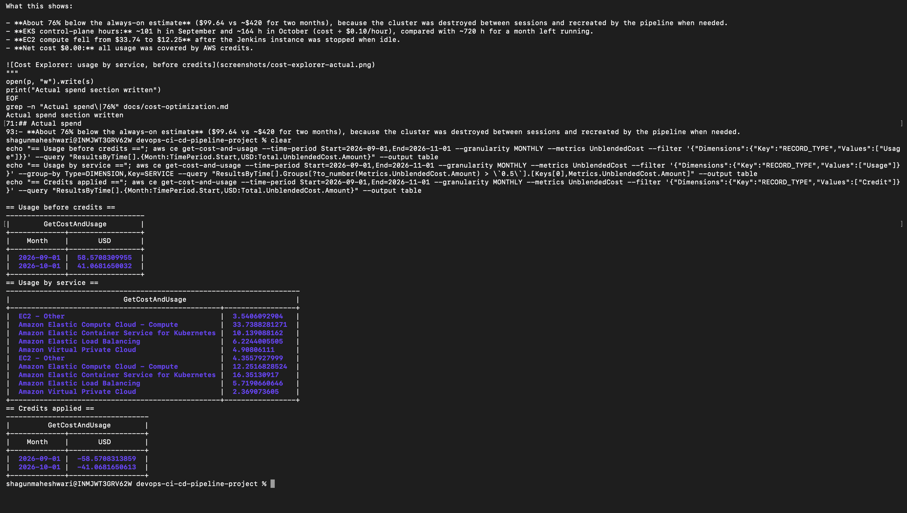

# Cost optimization (capstone — 10% evaluation)

This project targets a **dev/demo** budget, not production HA. Choices below keep spend predictable and teardown simple.

## Design choices that save money

| Choice | What we did | Production alternative |
|--------|-------------|-------------------------|
| NAT gateway | **Single** NAT in one AZ | NAT per AZ for HA |
| EKS nodes | `t3.medium`, 1–3 nodes (desired 2) | Larger types, more nodes |
| Jenkins | One `t3.medium` EC2 (Sprint 1) | Managed CI (CodePipeline, etc.) |
| LoadBalancers | App LB only; Grafana is ClusterIP (port-forward) | Ingress + single ALB |
| State | S3 + DynamoDB lock (minimal objects) | Same pattern, often shared bucket |
| Pipeline | Terraform plan on every run, apply only when the plan has changes (a poll-triggered build can still recreate a destroyed cluster, so disable the job while the cluster is down) | Separate infra job, or a guard that aborts when the cluster does not exist |

## Rough monthly cost (`ap-south-1`, everything running)

| Resource | Approx. USD/month |
|----------|-------------------|
| EKS control plane | ~$73 |
| 2× `t3.medium` worker nodes | ~$60 |
| NAT gateway + data | ~$32+ |
| Jenkins EC2 `t3.medium` | ~$30 |
| EBS, EIPs, ECR storage | ~$5–15 |
| **Total (always on)** | **~$200–220** |

See also [terraform.md](terraform.md#estimated-monthly-cost-if-left-running-continuously).

## Teardown workflow (recommended during development)

EKS control plane bills **24/7** until destroyed — there is no “stop cluster” option.

**Order matters.** Kubernetes creates the app's load balancer (and a `k8s-elb-*` security group) outside Terraform.
If they still exist, `terraform destroy` cannot delete the subnets and VPC, and the orphan keeps billing.

```bash
kubectl get svc -A | grep LoadBalancer          # list every load balancer Service
kubectl delete svc capstone-app -n capstone-app # releases the ELB
sleep 90
aws elb describe-load-balancers --region ap-south-1 --query "LoadBalancerDescriptions[].LoadBalancerName"   # expect []

cd terraform
terraform destroy   # removes VPC, EKS, nodes (Jenkins EC2 is manual unless imported)
```

Then verify nothing is left running: `aws eks list-clusters`, NAT gateways, unattached Elastic IPs and `available` EBS volumes.

- **Stop Jenkins EC2** when not demoing (saves compute; EBS still billed).
- **Keep ECR images** — storage is cheap; speeds rebuilds.
- **Keep S3 state bucket** — required for team Terraform; versioning adds minor cost.

## Autoscaling and right-sizing

- **HPA** (`kubernetes/hpa.yaml`): min 2, max 5 replicas on CPU 70% — avoids idle over-provisioning while allowing load demos.
- **Node group** (`node_min_size` 1, `max` 3): cluster can shrink to one node off-peak if you lower desired count manually or via cluster autoscaler (not installed in this capstone).

## Tags

All Terraform-managed resources use:

`Project=devops-capstone`, `Environment=dev`, `ManagedBy=terraform`

Use AWS Cost Explorer filtered by `Project` to audit spend.

## Viva talking points

1. Single NAT is the largest **conscious** HA tradeoff.
2. Destroy-between-sessions is the main **operational** cost lever for students.
3. Broad Jenkins IAM was accepted for speed; production would use a dedicated Terraform role with least privilege.

## Actual spend

Figures from AWS Cost Explorer (`aws ce get-cost-and-usage`, record type **Usage**, before credits).

| Period | Usage (before credits) | Credits applied | Net paid | If always on (estimate) |
|---|---|---|---|---|
| September 2026 | $58.57 | −$58.57 | $0.00 | ~$210 |
| October 2026 | $41.07 | −$41.07 | $0.00 | ~$210 |
| **Total** | **$99.64** | **−$99.64** | **$0.00** | **~$420** |

Usage by service:

| Service | Sep 2026 | Oct 2026 |
|---|---|---|
| EC2 compute (Jenkins + EKS worker nodes) | $33.74 | $12.25 |
| EKS control plane ($0.10/hour) | $10.14 | $16.35 |
| Elastic Load Balancing | $6.22 | $5.72 |
| VPC (public IPv4 addresses) | $4.91 | $2.37 |
| EC2 - Other (EBS volumes, NAT gateway, data transfer) | $3.54 | $4.36 |

What this shows:

- **About 76% below the always-on estimate** ($99.64 vs ~$420 for two months), because the cluster was destroyed between sessions and recreated by the pipeline when needed.
- **EKS control-plane hours:** ~101 h in September and ~164 h in October (cost ÷ $0.10/hour), compared with ~720 h for a month left running.
- **EC2 compute fell from $33.74 to $12.25** after the Jenkins instance was stopped when idle.
- **Net cost $0.00:** all usage was covered by AWS credits.


