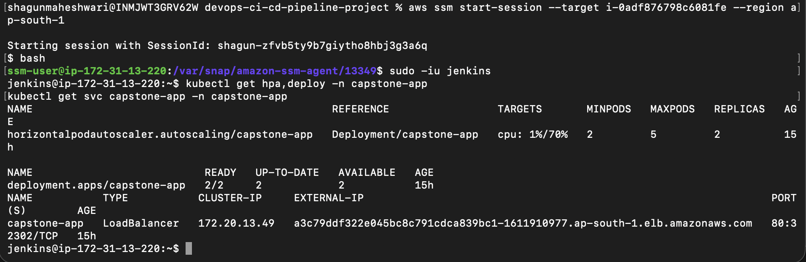
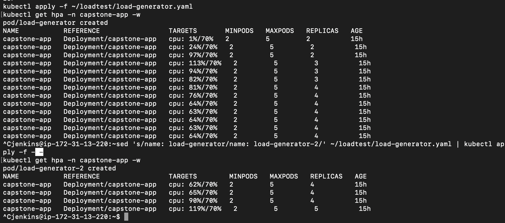
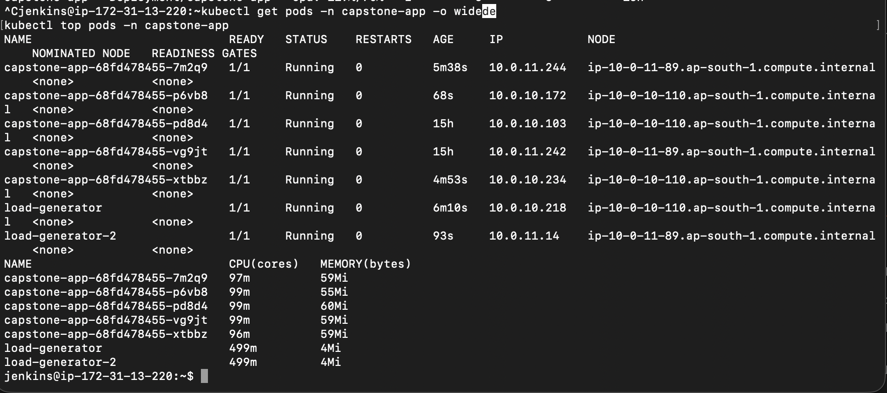
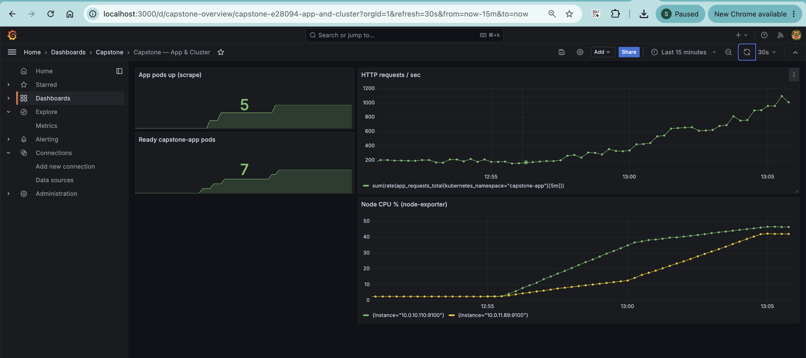
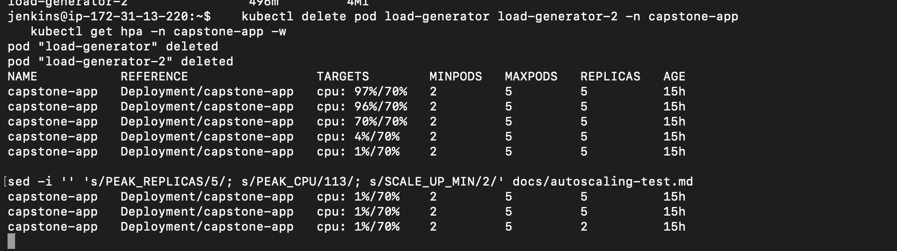

# Sprint 7 — Post-review pipeline improvements

Goal: harden the pipeline after review. Fail fast before touching infrastructure, scan images before they reach ECR, and change infrastructure only when Terraform detects a difference.

## Changes

| Change | Where | Why |
|---|---|---|
| CI stages run before Terraform (Test → Build → Scan → Push) | `jenkins/Jenkinsfile` | A failing test no longer triggers `terraform apply`; feedback in seconds instead of minutes |
| Trivy image scan, blocks CRITICAL vulnerabilities (`--ignore-unfixed`) | `jenkins/Jenkinsfile` (Scan image) | Vulnerable images never reach ECR or EKS; scanner runs as a container, nothing installed on the host |
| `docker build --pull` | `jenkins/Jenkinsfile` (Build image) | Always builds on the latest patched base image instead of a stale cached one |
| OS security updates in runtime stage | `app/Dockerfile` | Picks up Debian fixes published before the official Python image is rebuilt |
| Conditional apply via `terraform plan -detailed-exitcode` | `jenkins/Jenkinsfile` | Apply runs only when the plan has changes; most app-only commits skip it |
| metrics-server pinned to `v0.7.2` | `jenkins/Jenkinsfile` (Deploy) | Reproducible deploys; `latest` could change between runs |
| AWS account ID derived with `aws sts get-caller-identity` | `jenkins/Jenkinsfile` (Checkout) | No hardcoded account ID; pipeline is portable |
| `disableConcurrentBuilds()` | `jenkins/Jenkinsfile` | Two builds can never run Terraform at the same time |
| Old Docker images pruned after every build | `jenkins/Jenkinsfile` (`post { always }`) | Keeps the Jenkins host disk from filling up |
| `jenkins_role_arn` default set to `""` | `terraform/variables.tf` | Jenkins creates the cluster, so EKS already grants it admin as creator; avoids a duplicate access entry |
| Provider lock hashes for `linux_amd64` and `darwin_arm64` | `terraform/.terraform.lock.hcl` | The lock file must cover every platform that runs Terraform (Jenkins and laptop) |
| HPA load test (manual) | `kubernetes/tests/load-generator.yaml`, [autoscaling-test.md](autoscaling-test.md) | Proves pod autoscaling works: 2 → 5 pods under load, back to 2 afterwards |

New pipeline order:

```
Checkout → Test → Build image → Scan image → Push to ECR → Terraform Init → Plan → Apply (only if changes) → Ansible → Deploy → Smoke test → Monitoring → Validation
```

## Challenges and how they were solved

**1. Trivy blocked the image (3 CRITICAL CVEs in `perl-base`).**
The first scan on the Jenkins host failed with exit code 1. The vulnerabilities were in the Debian base image, and a fixed version was available. Cause: Docker reused a base image cached on the Jenkins host weeks earlier. Fix: `docker build --pull` fetched a newer `python:3.12-slim` (Debian 13.6 → 13.7) that already contained the patch. An `apt-get upgrade` step was added to the runtime stage as a safety net. The rescan reported `Total: 0`.

**2. Trivy could not download its database from the corporate network.**
TLS inspection on the corporate network caused `x509: certificate signed by unknown authority`. Scans were run on the Jenkins EC2 host instead, which is the environment the pipeline uses. If the scanner cannot run, the stage fails, so an unscanned image is never pushed (fail closed).

**3. Interrupted `terraform apply` left an orphaned EKS cluster.**
An aborted build stopped after AWS had started creating the cluster but before Terraform recorded it in state. The next apply failed with `ResourceInUseException: Cluster already exists`. Fix: `terraform import module.eks.aws_eks_cluster.main devops-capstone`. The follow-up plan showed `bootstrap_self_managed_addons = false -> true # forces replacement`. This is a create-only setting that cannot be read back on import. The cluster was empty, so Terraform was allowed to replace it.
Lesson: never abort a build during Terraform Apply.

**4. Duplicate EKS access entry for the Jenkins role.**
With `bootstrap_cluster_creator_admin_permissions = true`, EKS automatically gives the cluster creator an admin access entry. Jenkins was now the creator, so Terraform's own Jenkins access entry conflicted (`409 ResourceInUseException`). Fix: the entry was imported to unblock the run. The `jenkins_role_arn` default was then set to `""`, and both resources were removed from state with `terraform state rm` before applying, so Jenkins kept its access. If anyone other than Jenkins creates the cluster, pass `-var jenkins_role_arn=<jenkins role ARN>`.

**5. Provider checksum mismatch.**
`.terraform.lock.hcl` contained hashes for only one platform. Fix: `terraform providers lock -platform=linux_amd64 -platform=darwin_arm64`.

## Evidence

| Screenshot | Shows |
|---|---|
|  | Full successful run with the new stage order |
|  | Scan gate blocking 3 CRITICAL CVEs (exit code 1) |
|  | Rescan after `--pull`: `Total: 0` |
|  | Plan reports no changes, Terraform Apply skipped |
|  | Failing test stops the pipeline before any Terraform stage |
|  | Slack alert for the failed build |
|  | Jenkins access entry imported into state; the follow-up plan shows 1 to add, 1 to change |
|  | `/health` reachable through the load balancer |
|  | metrics-server running the pinned `v0.7.2` image |
|  | HPA baseline: 2 replicas, CPU 1% of target |
|  | HPA scaling 2 → 3 → 4 as CPU reached 113% |
|  | 5 replicas running across both nodes |
|  | Grafana during the load test |
|  | Back to 2 replicas after the load stopped |

## Future scope

- Native S3 state locking (`use_lockfile = true`) instead of the deprecated `dynamodb_table`
- Least-privilege IAM: separate Terraform execution role and CI role
- Alertmanager so Prometheus alert rules notify Slack
- Persistent volume for Prometheus data
- Cluster Autoscaler or Karpenter so HPA scale-ups get new nodes (the load test reached 5 pods without Pending pods, but larger loads would need more nodes)
- AWS Load Balancer Controller with an ALB, Ingress and TLS
- Manual approval gate before `terraform apply` for production
